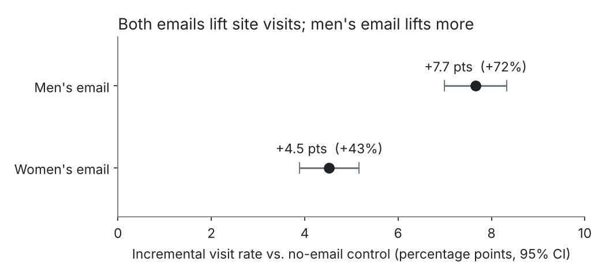
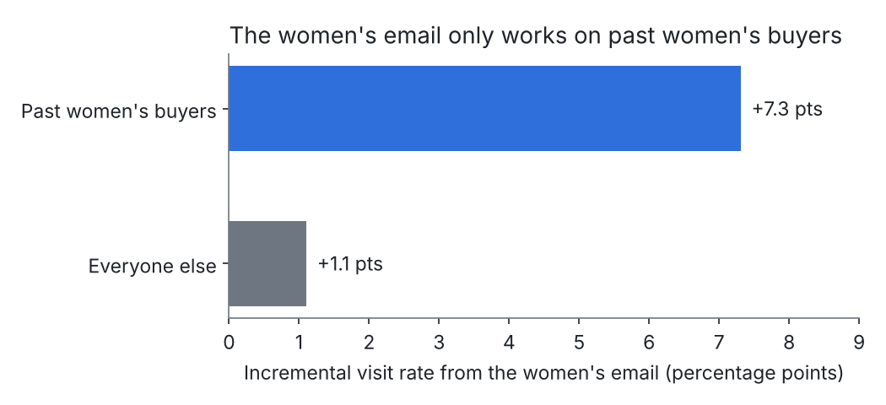
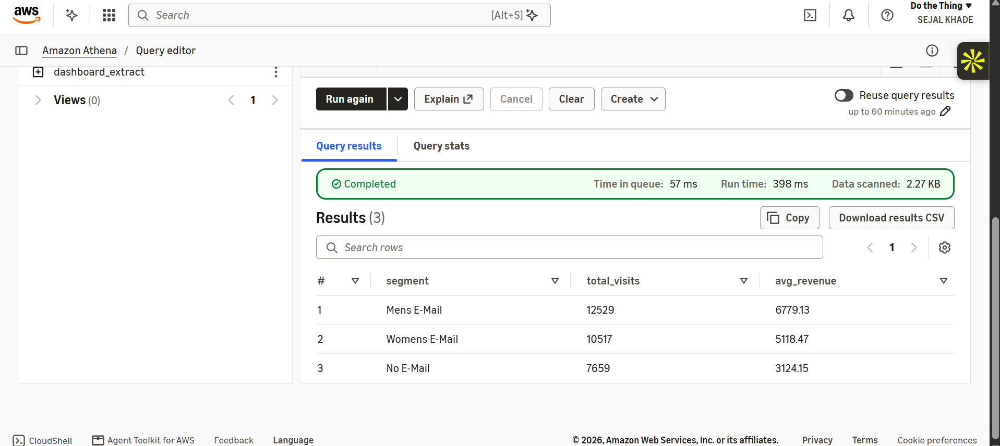

# Email Campaign Incrementality: Did the Email Cause the Sale?

An incrementality analysis of a real randomized email marketing test (64,000 customers). It measures how many site visits, orders and dollars each email campaign **caused** versus a no-email holdout, checks the randomization, finds which customers the campaigns work on, and turns that into a targeting rule.

Built with **SQL (DuckDB)**, **Python** (pandas, SciPy, statsmodels, scikit-learn) and **R** (independent replication of the core tests). Dashboard live in **[Looker Studio / Data Studio](https://datastudio.google.com/reporting/6153911e-814b-4850-9ded-90231a369f94)** — revenue by segment, total conversions, full data table.

## Data

The Kevin Hillstrom MineThatData E-Mail Analytics Challenge (2008): 64,000 customers who bought in the last 12 months were randomly split into three arms for a two-week test.

| Arm | Customers |
|---|---|
| Men's merchandise email | 21,307 |
| Women's merchandise email | 21,387 |
| No email (holdout control) | 21,306 |

Outcomes over the following two weeks: `visit` (went to the site), `conversion` (bought), `spend` (dollars). Pre-period fields: recency, prior-year spend (`history`), category bought (`mens`, `womens`), `zip_code`, `newbie`, purchase `channel`.

This is real customer behavior from a real experiment, not simulated data.

## Results

**1. The randomization is clean.** Arm sizes pass a sample ratio mismatch test (p = 0.90) and every pre-period covariate is balanced (largest |standardized mean difference| = 0.009, threshold 0.1). So differences after the send can be read as caused by the email.

**2. Both emails cause real lift.** All six tests stay significant after Holm correction for multiple comparisons.



| | Men's email | Women's email |
|---|---|---|
| Visit rate | 10.62% to 18.28%, **+7.66 pts** (95% CI 7.00 to 8.32), +72% | +4.52 pts (95% CI 3.89 to 5.16), +43% |
| Conversion rate | 0.57% to 1.25%, **+0.68 pts**, +119% | +0.31 pts, +54% |
| Revenue per customer | $0.65 to $1.42, **+$0.77** (95% CI $0.49 to $1.05) | +$0.42 (95% CI $0.17 to $0.68) |

**3. What 1,000 emails are worth.**

| Per 1,000 emails | Men's | Women's |
|---|---|---|
| Incremental visits | 77 | 45 |
| Incremental orders | 6.8 | 3.1 |
| Incremental revenue | $770 | $424 |
| Break-even cost per email | $0.77 | $0.42 |

Any send cost below the break-even line pays back on revenue alone (before margin).

**4. The women's email only works on past women's buyers.** For customers who bought women's merchandise last year it lifts visits by 7.3 pts; for everyone else, by 1.1 pts. The difference is significant in a logistic regression interaction test (p = 4.6e-15).



**Targeting rule:** send the women's email only to past women's buyers (55% of the list). That cuts sends by 45% and keeps 89% of the incremental visits. The men's email lifts every channel, zip and spend-tier segment by 6 to 10 pts, so it goes to everyone.

**5. Two methods that did not help, and why they are reported anyway.**
- **CUPED** variance reduction using prior-year spend cut variance by less than 0.1%, because last year's spend barely predicts two-week spend here. The unadjusted estimates are reported.
- A **T-learner uplift model** (gradient boosting) for the men's email, scored on a 12,784-customer holdout, captured 32% of incremental visits when targeting its top 30%, almost the same as random targeting (30%). The men's email works broadly, so a model adds little over emailing everyone. The simple category rule in finding 4 beats it.

## How to run

```bash
pip install -r requirements.txt
python src/analysis.py        # all numbers -> output/results.json and CSVs
Rscript R/incrementality.R    # R replication -> output/r_ate.csv
python src/charts.py          # charts -> docs/
pytest -q                     # 8 tests, including Python vs R agreement
```

## Repo layout

```
data/hillstrom.csv            raw experiment data (64,000 rows)
sql/01_campaign_funnel.sql    funnel and revenue per arm (DuckDB)
sql/02_lift_by_segment.sql    incremental lift by channel, zip, newbie, spend tier
src/stats.py                  tested helpers: z-test, Welch t-test, CUPED, SRM, SMD, Qini
src/analysis.py               full pipeline; writes output/
src/charts.py                 README charts
R/incrementality.R            base-R replication: prop.test, t.test, glm interaction
tests/test_stats.py           unit tests + Python/R agreement check
output/dashboard_extract.csv  tidy extract for Looker Studio or Tableau
docs/LOOKER_STUDIO.md         how to build the dashboard
```

## Limits

- The test ran in 2008 on one retailer's list; email response rates today are different.
- Outcomes cover only two weeks, so longer-term or cannibalized sales are not measured.
- Break-even ignores product margin and send cost, which the data does not include.

## Source

Kevin Hillstrom, MineThatData E-Mail Analytics and Data Mining Challenge (March 2008). Copy obtained from a public GitHub mirror; SHA-256 of `data/hillstrom.csv`: `00a6a868e05a9ffe7382da51629f6d6dce88c5acfc945e79d314ebc78fd3a2c0`.

## Infrastructure

Data stored in **AWS S3** (`sejal-analytics-data` bucket) and queried with **Amazon Athena** (external table over `dashboard_extract.csv`).

**Athena query run:**
```sql
SELECT segment, SUM(visits) as total_visits, ROUND(AVG(revenue), 2) as avg_revenue
FROM dashboard_extract
GROUP BY segment
ORDER BY avg_revenue DESC;
```

**Results:**

| segment | total_visits | avg_revenue |
|---|---|---|
| Mens E-Mail | 12,529 | $6,779.13 |
| Womens E-Mail | 10,517 | $5,118.47 |
| No E-Mail | 7,659 | $3,124.15 |

Email-treated customers generated **2.2× the average revenue** of the holdout group. Full query results screenshot:


